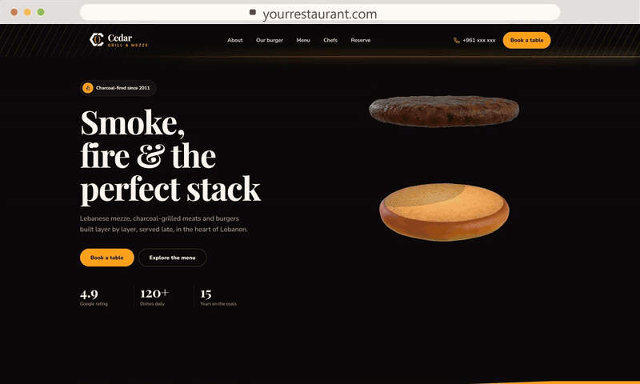
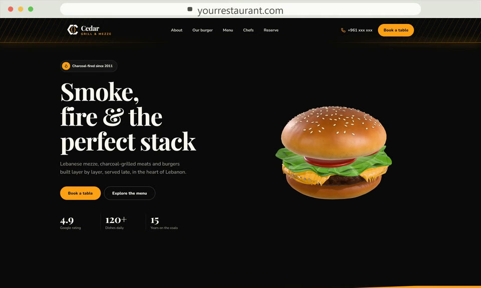
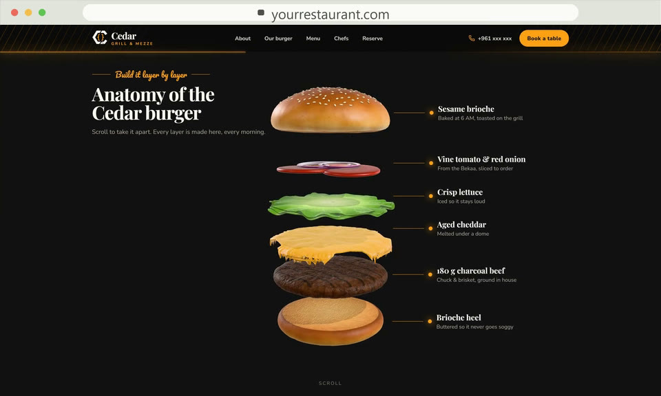
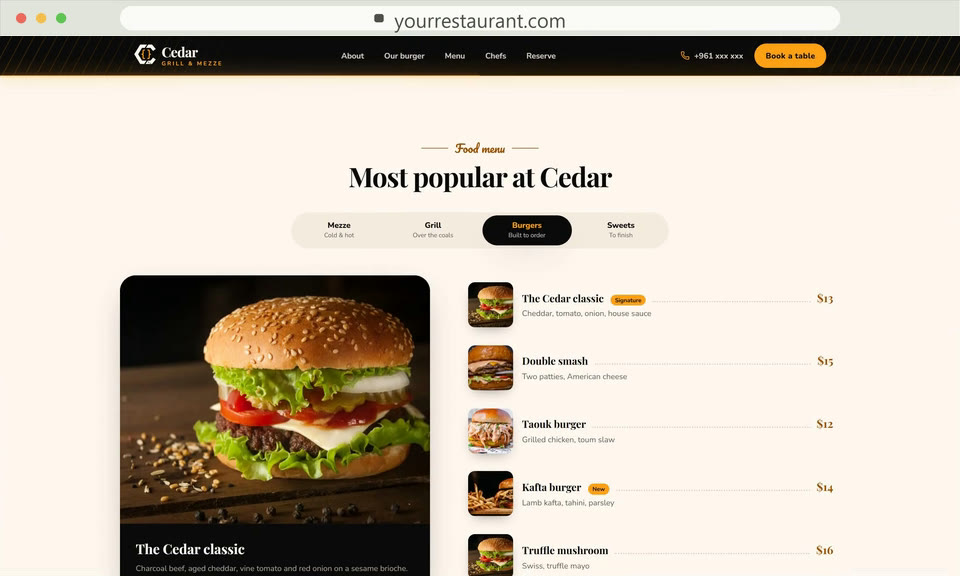

# Cedar · Grill & Mezze House

**A restaurant website where the food is the hero: a 3D burger that builds itself, follows your cursor, and comes apart layer by layer as you scroll.**

## The problem

Most restaurant websites are a photo, a PDF menu and a phone number. They look the same as every other restaurant's site, they don't make anyone hungry, and booking a table still means calling.

## The solution

A one-page website built around real-time 3D food. Visitors watch the signature burger assemble on screen, scroll to see every layer separated and named, browse the menu by category, and book a table online, all on one page that runs smoothly on phones and laptops.

## Key features

- **3D hero:** the burger drops in layer by layer, turns slowly and follows the cursor, with embers rising behind it.
- **"Anatomy of the burger":** a scroll section that pulls the burger apart into six labelled layers.
- **Menu** with category tabs, a feature photo and prices.
- **Online table booking** with the form checked in the browser and again on the server.
- **Smooth on any device:** 60 fps while scrolling, even on laptops with basic graphics; shows a photo instead when 3D isn't supported, and calms the motion for visitors who prefer less animation.

## Screenshots

| Hero | Anatomy |
| --- | --- |
|  |  |

| Menu | Table booking |
| --- | --- |
|  |  |

## Tech stack

| | |
| --- | --- |
| **Languages** | TypeScript, CSS |
| **Framework** | Next.js 16 (React) |
| **3D** | Three.js, React Three Fiber, Blender (3D models and textures) |
| **Styling and motion** | Tailwind CSS, Motion, Lenis smooth scroll |
| **Forms** | React Hook Form, Zod |
| **Testing** | Vitest |

---

> **Source code is private.** For hiring or client review, code access is available on request: DM [@cedarcode.lb](https://instagram.com/cedarcode.lb) or visit [cedarcodesite.com](https://cedarcodesite.com).

© 2026 CedarCode. All rights reserved.
